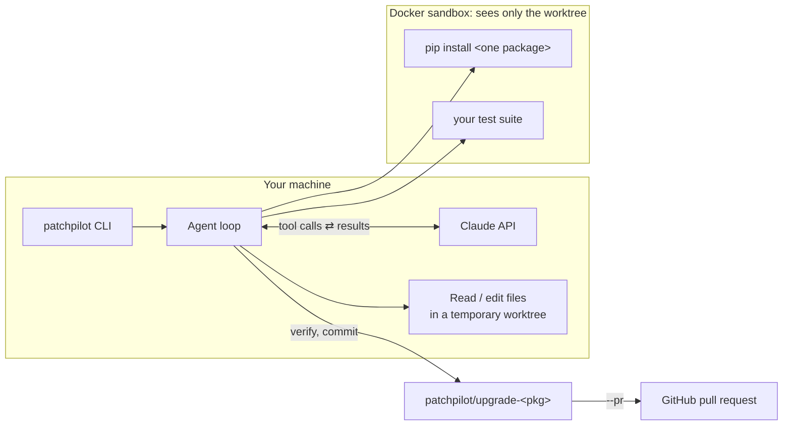

# patchpilot

[](https://github.com/ilmeedesilva/patchpilot/actions/workflows/ci.yml)
[](https://pypi.org/project/patchpilot/)

[](https://github.com/ilmeedesilva/patchpilot/blob/main/LICENSE)

**An AI agent that upgrades a dependency, fixes the code that breaks, and opens a pull request explaining what changed and why.**

Dependabot and Renovate bump version numbers. When the new version breaks your build, the fix is still on you. patchpilot does that part: it upgrades the package inside a sandbox, runs your tests, reads the failures and the changelog, edits your code until the tests pass, and hands you a reviewable PR.


👉 **[See the pull request it opened](https://github.com/ilmeedesilva/patchpilot-demo/pull/1)**: the description, the diff, and the verification note were all written by patchpilot.

🤖 **[See a PR it opened on its own](https://github.com/ilmeedesilva/patchpilot-demo/pull/3)**: the [GitHub Action](#use-it-in-github-actions) picked an outdated package (marshmallow 3 → 4), fixed the code, and opened this PR as `github-actions[bot]`.

✍️ **[Read the write-up](https://dev.to/ilmeedesilva/i-built-an-ai-agent-that-fixes-the-code-a-dependency-upgrade-breaks-2664)**: how it works and what I learned building it.

```console
$ patchpilot upgrade . pydantic --pr
• Creating an isolated copy of the repo on branch patchpilot/upgrade-pydantic
• Starting a Docker sandbox (python:3.13-slim) and installing the project
• Running the tests before upgrading
• Agent is upgrading pydantic
  → read_dependencies {}
  → get_latest_version {"package": "pydantic"}
  → pip_install {"requirement": "pydantic==2.14.1"}
  → run_tests {}                      # fails: BaseSettings moved out of pydantic
  → pip_install {"requirement": "pydantic-settings==2.16.2"}
  → write_file {"path": "app/config.py"}
  → write_file {"path": "app/models.py"}
  → run_tests {}                      # passes
• Re-running the tests to verify the agent's work
• Pull request: https://github.com/ilmeedesilva/patchpilot-demo/pull/1
```

The PR description is written by the agent, and includes:

> **Breaking changes**
> - **`BaseSettings` moved to `pydantic-settings`**: importing it from `pydantic` now fails. Installed `pydantic-settings`, added it to `requirements.txt`, and now import from `pydantic_settings`.
> - **`@root_validator` without `skip_on_failure=True` is an error in v2**: replaced with `@model_validator(mode="after")`.
> - …
>
> **Needs your attention**
> - In v1 the password check ran even when another field had failed; in v2 it only runs once all fields are valid, so a bad email plus mismatched passwords now reports only the email error.

*(Trimmed output and report from a real run on [`examples/pydantic-demo`](https://github.com/ilmeedesilva/patchpilot/tree/main/examples/pydantic-demo).)*

## Quick start

You need Python 3.11+, [Docker Desktop](https://www.docker.com/products/docker-desktop/) running, and an [Anthropic API key](https://console.anthropic.com/settings/keys).

```bash
pipx install patchpilot
export ANTHROPIC_API_KEY=sk-ant-...      # or put it in a .env file where you run patchpilot

cd your-project                          # a git repo with a test suite
patchpilot analyze .                     # read-only report: what's outdated, what's risky
patchpilot upgrade . pydantic            # upgrade + fix, committed to a new branch
patchpilot upgrade . pydantic --pr       # ...and open a pull request
patchpilot upgrade . --auto --pr         # let patchpilot pick the next outdated package
```

Or let it run every week by itself: see [Use it in GitHub Actions](#use-it-in-github-actions).

Each run uses Anthropic API credit. The amount depends on the size of the project and how much breaks.

## Usage

### `patchpilot analyze <project>`

Reads your dependency files, checks PyPI for the latest versions and runs your tests once, then prints a Markdown report. It covers what's outdated, which upgrades are major-version jumps likely to need code changes, and a suggested order. It changes nothing.

### `patchpilot upgrade <project> <package>` or `--auto`

1. Checks that `<package>` really is a dependency of `<project>`. If it's declared in a subfolder instead, it tells you which one.
2. Makes a separate checkout of your repo (a git worktree) on a new branch, `patchpilot/upgrade-<package>`. **Your working copy is never touched.**
3. Starts a Docker sandbox, installs your project into it, and checks that the tests pass *before* changing anything.
4. Lets the agent work: upgrade the package, run the tests, read the failures and changelog, edit the code, and repeat.
5. **Re-runs the tests itself** instead of trusting the agent's word, then commits to the branch with the agent's report as the commit message.

Review the result with `git diff HEAD...patchpilot/upgrade-<package>`, then merge it or delete it.

| Option | |
|---|---|
| `--auto` | Pick the package for you instead of naming it: one whose newest release is outside the range you declared and that doesn't already have a `patchpilot/upgrade-*` branch, locally or on GitHub. The choice is made by plain code, not the AI. If nothing needs upgrading, it says so and exits successfully. |
| `--prefer smallest` | With `--auto`: start with the `smallest` version jump (the default, and the safest) or the `largest`. |
| `--pr` | Push the branch and open a GitHub pull request. If the tests still fail, it's opened as a **draft**. Uses the [GitHub CLI](https://cli.github.com/), so patchpilot never handles a GitHub token. |
| `--test-command "..."` | How to run your tests (default: `python -m pytest -q`). |
| `--image python:3.11-slim` | Docker image to run in. Match it to your project's Python version (default: `python:3.13-slim`). |
| `--no-docker` | Use a local virtualenv instead of Docker. Faster, but your project's code runs directly on your machine. |

## Use it in GitHub Actions

Add this file to your repo as `.github/workflows/patchpilot.yml`. Every Monday, patchpilot picks the next outdated package, upgrades it, fixes your code, and opens a pull request:

```yaml
name: patchpilot

on:
  schedule:
    - cron: "0 6 * * 1"  # every Monday at 06:00 UTC
  workflow_dispatch:      # adds a "Run workflow" button on the Actions tab

permissions:
  contents: write
  pull-requests: write

concurrency:
  group: patchpilot

jobs:
  upgrade:
    runs-on: ubuntu-latest
    steps:
      - uses: actions/checkout@v5
      - uses: ilmeedesilva/patchpilot@v0.2.0
        with:
          anthropic-api-key: ${{ secrets.ANTHROPIC_API_KEY }}
```

Then, in your repo's settings:

1. **Secrets and variables → Actions**: add a secret named `ANTHROPIC_API_KEY`.
2. **Actions → General → Workflow permissions**: tick **Allow GitHub Actions to create and approve pull requests**.

Runs with nothing new to upgrade finish in seconds and don't call the API, because packages that already have an open patchpilot PR are skipped. See it working in [patchpilot-demo](https://github.com/ilmeedesilva/patchpilot-demo/pull/3).

| Input | Default | |
|---|---|---|
| `anthropic-api-key` | (required) | Your Anthropic API key, from a secret. |
| `package` | `auto` | A package name, or `auto` to pick the next outdated one. |
| `prefer` | `smallest` | With `auto`: `smallest` or `largest` version jump first. |
| `working-directory` | `.` | The project folder, if it isn't the repo root. |
| `test-command` | `python -m pytest -q` | How to run your tests. |
| `python-version` | `3.13` | Your project's Python version (picks the `python:<version>-slim` image). |
| `sandbox` | `docker` | `docker` runs your project's code in a container that can't see your API key or GitHub token. `none` runs it on the runner directly. |
| `github-token` | the workflow's token | PRs opened with the default token don't trigger your other workflows (a GitHub rule). To have CI run on them, pass a fine-grained token with contents and pull-request write access, and give the same token to `actions/checkout`. |

## How it works



At the centre is a hand-written [tool-use loop](https://github.com/ilmeedesilva/patchpilot/blob/main/src/patchpilot/agent.py). patchpilot sends Claude the task and a list of tools. Claude replies with the tool it wants to call, patchpilot runs it and sends back the result, and this repeats until Claude writes its final report. Claude decides *what* to do next; patchpilot's code is the only thing that *does* anything.

| Tool | Runs where | What it does |
|---|---|---|
| `read_dependencies` | host | Parses `requirements*.txt` and `pyproject.toml` |
| `get_latest_version` | host | Queries PyPI, including changelog URLs |
| `list_files`, `read_file` | host | Read-only, confined to the project folder |
| `edit_file`, `write_file` | host | Exact-match edits; refuses `.git/` and virtualenvs |
| `pip_install` | **sandbox** | One requirement at a time; flags, URLs and file paths are rejected |
| `run_tests` | **sandbox** | Your test command, with a timeout |
| `web_fetch` | Anthropic | Reads changelogs and migration guides |

### Safety

Upgrading means running code that isn't yours: your tests, and whatever a package runs when it installs. So that code runs inside a Docker container that:

- mounts **only the temporary worktree**, not your home folder, SSH keys or other projects
- runs as your user, not root, with all Linux capabilities dropped and `no-new-privileges`
- is capped at 2 CPUs, 2 GB of memory and 512 processes
- is deleted when the run ends, even if the run fails

The agent loop and your API key never enter the container. These properties are checked by [integration tests](https://github.com/ilmeedesilva/patchpilot/blob/main/tests/test_sandbox.py), not just described here.

### Design decisions

- **Verify, don't trust.** The agent says when it's done, but patchpilot re-runs the tests itself before committing. The ✅ in the output is patchpilot's verdict, not the model's.
- **Refuse to run when "tests pass" would mean nothing.** patchpilot stops if the tests already fail before the upgrade, or if the package isn't a dependency of the folder you pointed it at. Otherwise a green result could be meaningless.
- **Fail before spending, not after.** Docker, GitHub login, remotes and branch names are all checked before the first API call.
- **Leave nothing behind.** The worktree, container and virtualenv are cleaned up on success, failure or Ctrl-C. A branch only survives if it has a commit worth reviewing.
- **A small, explicit tool surface** instead of a general shell. It's easier to reason about what the agent can do, and easier to sandbox.

## Limitations

- Python projects only, with `requirements*.txt` or a PEP 621 `pyproject.toml` (no Poetry or uv lockfiles yet).
- One package per run.
- The fix is only as good as your tests. If they don't cover what changed, patchpilot can't catch it, though the agent flags behaviour changes it notices under **Needs your attention**.
- The sandbox needs network access to install packages, so code inside it can reach the internet.

## Roadmap

- [x] GitHub Action: run weekly and open PRs automatically
- [ ] Upgrade several packages in one run, ordered by risk
- [ ] Turn off the sandbox's network access while tests run
- [ ] uv and Poetry lockfile support

## Development

```bash
git clone git@github.com:ilmeedesilva/patchpilot.git && cd patchpilot
python3 -m venv .venv && source .venv/bin/activate
pip install -e ".[dev]"
pytest          # Docker tests are skipped if Docker isn't running
ruff check . && ruff format --check .
```

The test suite doesn't call the Anthropic API: the agent is replaced with a fake that makes known edits, and GitHub with a local bare repo plus a stand-in `gh`.

## License

[MIT](https://github.com/ilmeedesilva/patchpilot/blob/main/LICENSE)
